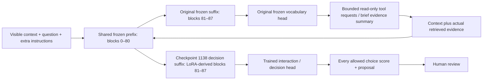

# Handoff 2: optional context refinement on the shared Nemotron backbone

Read [handoff 1](INTEGRATION_PROMPT.md) first. This is the follow-up brief for the
coding model implementing the demo. Preserve existing team changes and all
medical-image / saved-example features.

## User's requested behavior

**Refinement is OFF by default.** The normal decision request must remain exactly
as before: no generated text, no extra prompt, no automatic question duplication,
and no tool access. Enabling it is an explicit user action.

When enabled, append the question (and its allowed choices) to the visible
context automatically. Append a configurable natural-language instruction field
as a separate task-instruction section, for example “Give a quick review of the
available history.” Its default value is empty; the interface has a placeholder.
Do not make the user author raw API/decision JSON.

Use the **original pretrained, frozen Nemotron vocabulary head** to generate a
brief evidence refinement and request permitted tools. “Original/untrained head”
means not fine-tuned on this decision task; it does not mean random weights.
After refinement, the checkpoint's trained LoRA decision path and interaction
head score the original allowed answers. A human still chooses the action.

**Do not substitute another LLM service or load another complete 120B model.**
The reference implementation shares frozen weights with the decision model.

## Correct shared architecture



These are shared **weight objects**, not a promise that all activations or KV
caches can be reused. Context changes require valid cache invalidation. Do not
claim a measured compute saving or mix caches from different branches/patients.

The current NF4 serving loader merges decision LoRA into the final layers and
replaces `lm_head` with `Identity`. Therefore restoring only a vocabulary head
would still use the adapted decision suffix. To preserve the original generation
path, capture the original final seven blocks and original head **before LoRA
attachment, merging, CUDA guards or pooling-hook installation**. Quantize that
small suffix separately using the same expert quantizer. Share the unchanged
first 81 blocks, embedding and other unchanged model components. Do not try to
numerically unmerge quantized weights.

`shared_generation.py` implements capture, NF4 preparation and branch switching.
It temporarily selects the original suffix/head under the **same prediction
lock** used by the classifier and restores the decision suffix/head in `finally`,
including on errors. The classification pooling hooks stay on the decision
suffix; they must not fire for reference generation. Original generation weights
remain frozen. Text generation uses a fresh generation call and a hard new-token
limit. This refinement phase is text-only; the final decision request preserves
its original image IDs for the multimodal scorer.

## Budget and tool protocol

Defaults, enforced on the backend:

| Setting | Default | Hard maximum |
| --- | ---: | ---: |
| Total new generated tokens, across every turn | 128 | 512 |
| Generation turns | 3 | 4 |
| Read-only tool calls | 2 | 4 |
| Refined context characters | 12,000 | 20,000 |
| Additional instruction characters | 0 | 2,000 |

The token budget includes tool-call JSON and the final evidence summary, not
just the summary. `SharedNemotronGenerator` also checks tokenized input plus the
remaining generation budget against the native input limit (4096 by default).
Inputs and records are never silently truncated. An incomplete generation is
not appended as patient evidence; the result shows its stop reason.

Generation returns one small JSON object internally:

```json
{"tool":"retrieve_information","arguments":{"patient":"sim:demo-record"}}
```

or `retrieve_test_results` with the same permitted patient, or:

```json
{"summary":"A brief summary grounded in the available source records."}
```

This structured protocol is an implementation detail, not the user interface.
The generated text is a brief evidence summary, not a displayed chain of thought
or a final clinical decision. Actual tool results remain separate from generated
summaries, which may contain errors. Never send prior classifier scores or its
proposed action back as evidence.

`PatientTools` in `reasoning.py` provides working `retrieve_information(patient)`
and `retrieve_test_results(patient)` adapters for the synthetic store in
`patient_records.json`. They return only visible, whitelisted source entries.
Another patient, a caller-invented future step, unknown tools, arbitrary paths,
URLs, write operations and unrestricted function execution are rejected. The
server's `max_visible_step`, not a requested step alone, bounds access.

For real project records, replace the adapter with your backend's authorized
record/session lookup. Bind patient identity and visibility to that session;
do not accept a whole hidden simulator patient from the browser. The published
skin photographs have no real EHR link here. The reference UI demonstrates
patient tools on the synthetic pathway; photo scoring remains separate.

## Frontend / proxy interface

The optional `<birch-decision>` panel has an unchecked refinement toggle, token
budget selector, additional-instructions field, tool preview and readable
context/evidence trace. It automatically appends questions only when enabled.
A custom patient request also needs `element.patient` set to its permitted record
reference. Stale requests are still cancelled/ignored.

```js
const result = await api.reason({
  request: scoreRequest, // or pathwayRequest; unchanged questions and choice IDs
  patient: 'sim:demo-record',
  as_of_step: 1,
  reasoning: {
    enabled: true,
    max_tokens: 128,
    max_rounds: 3,
    max_tool_calls: 2,
    additional_prompt: 'Give a quick review of the available history.',
  },
});
renderToolTrace(result.refinement.trace);
renderContext(result.refinement.context);
renderScores(result.decision); // human review still uses decision.id
```

The same-origin routes are:

- `POST /api/decision/reason`: optional native refinement followed by normal
  scoring. When disabled, directly scores the original request.
- `POST /api/decision/refine-preview`: local, explicitly **scripted** generator
  plus actual synthetic record retrieval. Returns a context/trace, **no scores**.
  It does not contact Modal, require a key, or pretend to use Nemotron.

Both accept either `request` or `example_id`, plus the settings shown above.
Use `api.refinePreview(...)` for the second route. A saved trace is also provided
at `web/reasoning-preview.json`. It is labelled `scripted_tool_preview`; it must
never be presented as a recorded native Nemotron reasoning run.

Keep existing saved classifier outputs distinct. A refined preview does not
recompute the four existing saved examples, and their scores must not be
presented as results of the new refined context.

## Native model-server owner work and current status

**The live Modal classifier has not been redeployed for this feature.** The
shared-base generator helper, budget/tool state machine, optional native FastAPI
hook and owner-runtime patch are prepared. Full Nemotron generation, GPU memory,
latency and score consistency still need a one-GPU preflight. Do not enable the
live-refinement UI flag before that succeeds. No external generation service,
second full backbone or additional GPU has been provisioned.

Owner-only patch: `runtime/shared-refinement.patch`, generated and checked
against the inference checkout's current files:

- `decision_model/inference_quantized.py`: optional capture before adaptation;
  original-suffix quantization; attach shared generator with the existing lock.
- `decision_model/serve.py`: authenticated native hook and a health capability.
- `deploy/modal_inference.py`: include the lightweight adapter source and expose
  the optional runtime flag; keep one GPU, min0/max1 and existing idle policy.

In the existing inference checkout, first copy this version of `decision_api/`
from the team branch, preserve local changes, then check/apply the patch:

```bash
git apply --check /path/to/team-checkout/decision_api/runtime/shared-refinement.patch
git apply /path/to/team-checkout/decision_api/runtime/shared-refinement.patch
```

Do not apply it blindly to `main`, which does not contain the training/inference
runtime. Do not overwrite training files or deploy to GPUs occupied by training.
The patch's generation capability is disabled unless the owner deploys with
`BIRCH_ENABLE_REFINEMENT=1`. This capability flag loads the extra original suffix
and vocabulary head; it does not switch refinement on for user requests.

`native_refinement.install_refinement_route` exposes authenticated
`POST /v1/context/reason` and scores through the existing service after refinement.
Native request contracts are validated, and future pathway observations are
removed before the generation context is assembled. Existing decision traces
retain the exact final scoring context. Keep the returned structured refinement
trace alongside `decision.id` in the app log; do not overwrite original decisions.

Required owner preflight before exposing it:

1. Verify original-head generation uses the unadapted suffix; LoRA never leaks
   into that path. Shared-prefix tensor identities must be unchanged.
2. Verify the decision branch and lock are restored after normal completion,
   generation failures and token-budget exhaustion.
3. Measure one-GPU peak memory during load, prefill and generation. The original
   suffix/head add memory; no full-model memory-fit guarantee is claimed.
4. Check total generated tokens, tool budget, cross-patient/future filtering,
   malformed outputs and bounded startup/error behavior.
5. Compare classifier scores before/after generation on identical inputs and
   check mixed/concurrent calls. Do not silently allocate extra GPUs on failure.

Only after success, set `BIRCH_NATIVE_REFINEMENT_ENABLED=1` on the team proxy.
The default is0; with the old server, the UI offers the honest scripted preview
and keeps native refinement disabled. Normal live scoring remains available.

No training, checkpoint, overnight-schedule or live-deployment changes have been
made as part of this handoff. Overnight pausing remains with the owner/team.
